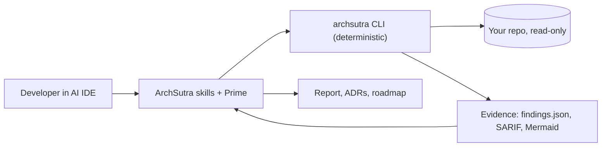

# ArchSutra AI - Software Architecture Review Agent for Claude Code, Cursor, Codex, Copilot & Gemini CLI

**Design. Audit. Evolve.**

ArchSutra AI is an open-source **software architecture agent**: a set of portable [Agent Skills](https://agentskills.io/specification) and 12 specialist sub-agent roles (led by **ArchSutra Prime**) that turn your AI coding assistant into an evidence-first architect. Alongside the skills ships a **keyless CLI** that maps a repository, audits it, and exports Markdown, Mermaid, JSON and SARIF reports.

> **No extra API key.** Inside a supported AI IDE, ArchSutra uses that IDE's own model. You need access to the IDE, not to an ArchSutra account. The CLI is deterministic, offline and read-only. Optional provider-backed server inference is not part of v0.1 and, when added, will be separately configured and may cost money.

Created by **[Vatsal Shah](https://github.com/shahvatsalofficial)**. Apache-2.0.

## What you get

| Capability | How | Needs AI model? |
|---|---|---|
| Architecture audit with severity, confidence and `file:line` evidence | `archsutra audit` + `architecture-audit` skill | CLI no, skill yes |
| Reverse-engineer modules, dependencies, import cycles | `archsutra map` | No |
| Secret, injection, TLS, container, IaC, supply-chain checks (redacted output) | `archsutra audit` | No |
| C4-style context/container diagrams (Mermaid) | `archsutra export` | No |
| SARIF 2.1.0 for GitHub code scanning | `archsutra export` | No |
| Greenfield design, options, ADRs, roadmap | `architecture-design` skill | Yes (your IDE) |
| Threat modeling (STRIDE + LLM/agent threats) | `threat-modeling` skill | Yes (your IDE) |
| Monolith-to-services / cloud migration planning | `architecture-modernization` skill | Yes (your IDE) |
| Validate skills, links, diagrams, findings schema | `archsutra verify` | No |
| Safe, reversible install into 5 AI IDEs | `archsutra install` / `uninstall` | No |

## 60-second start

Requires Node.js 20+.

```bash
# audit any repo (read-only, no network, no API key)
npx github:shahvatsalofficial/archsutra-ai audit .

# install the skills into your project for your AI IDE
npx github:shahvatsalofficial/archsutra-ai install --host claude --target . --dry-run
npx github:shahvatsalofficial/archsutra-ai install --host claude --target .
```

Then ask your assistant:

> ArchSutra Prime: audit this repository's architecture. Establish what the code actually does first, then give findings with file and line evidence, severity and confidence, prioritized fixes, ADR recommendations and a phased roadmap. Stay read-only and label unknowns.

Write the full report set to `docs/architecture/`:

```bash
npx github:shahvatsalofficial/archsutra-ai export . --output docs/architecture
```

## Supported AI IDEs

Support levels are stated plainly. "adapter" means ArchSutra writes the files in the layout the vendor documents; it has **not** yet been smoke-tested inside each live host.

| Host | Level | Skills location | Sub-agents | Notes |
|---|---|---|---|---|
| Claude Code | adapter | `.claude/skills/` | `.claude/agents/` (read-only tools) | |
| Cursor | adapter | `.cursor/skills/` | no | skills only |
| OpenAI Codex | adapter | `.agents/skills/` | no | adds a managed block to `AGENTS.md` |
| GitHub Copilot | adapter | `.github/skills/` | `.github/agents/*.agent.md` | only `description` and `tools` frontmatter written |
| Gemini CLI | experimental | `.gemini/skills/` | no | layout unconfirmed for current release |

Details and verification status: [docs/compatibility/matrix.md](docs/compatibility/matrix.md).

Installs are idempotent and reversible. Files you edited are never overwritten without `--force` (originals are backed up to `.archsutra/backup/`), and `uninstall` removes only files it installed and you did not modify.

## The agent team

| Agent | Focus |
|---|---|
| [Prime](agents/prime.md) | Orchestrator: scoping, delegation, synthesis |
| [Atlas](agents/atlas.md) | Enterprise and solution architecture, bounded contexts |
| [Blueprint](agents/blueprint.md) | C4, HLD/LLD, ADRs, diagrams |
| [Sentinel](agents/sentinel.md) | Security, STRIDE, OWASP, privacy |
| [Cloud](agents/cloud.md) | Cloud/hybrid topology, IaC, DR |
| [Data](agents/data.md) | Data models, consistency, migrations |
| [Nexus](agents/nexus.md) | APIs, events, integration contracts |
| [Neural](agents/neural.md) | LLM apps, RAG, agent safety |
| [Scale](agents/scale.md) | SLOs, capacity, reliability |
| [Ledger](agents/ledger.md) | Cost, FinOps, lock-in |
| [Forge](agents/forge.md) | Refactoring and migration task plans |
| [Verify](agents/verify.md) | Evidence integrity and quality gate |

Real sub-agent spawning depends on the host. Where unavailable, Prime performs the specialist reviews sequentially.

## CLI reference

```text
archsutra init|doctor|map|audit|verify|export [path]
archsutra install|uninstall --host <claude|cursor|codex|copilot|gemini> [--target dir] [--dry-run] [--force]
archsutra hosts
Flags: --json  --dry-run  --output <dir>  --fail-on <critical|high|medium|low>  --verbose  --version  --help
```

Exit codes: `0` ok, `1` findings at/above `--fail-on` or install conflict or failed doctor, `2` usage error, `3` command needs a model (run via skill), `4` verification failed, `5` internal error.

Workflows that need semantic reasoning (`design`, `review`, `threat-model`, `modernize`, `compare`, `cost`, `drift`) exit `3` with a pointer to the matching skill. The CLI never pretends a parser can reason, and never calls a model API.

### Use it in CI

```yaml
- run: npx github:shahvatsalofficial/archsutra-ai audit . --fail-on high
```

## Example output (illustrative)

```text
AS-SEC-001#001 critical  Possible hard-coded credential   src/services/svc.ts:1  aws-access-key: key = "[REDACTED:aws-access-key]"
AS-SEC-005#002 high      SQL built by string interpolation src/services/svc.ts:2
AS-ARC-001#005 medium    Circular dependency (src/a <-> src/b)
```

Every finding carries: stable ID, severity, confidence, evidence (`observed` / `inferred` / `unknown`), impact, fix, verification and acceptance criteria. Schema: [schemas/findings.schema.json](schemas/findings.schema.json).

## How it works



The deterministic CLI gathers reproducible evidence. The IDE's own model reasons over it through the skills. Details: [docs/architecture/overview.md](docs/architecture/overview.md) and the [RFC](docs/rfc/0001-archsutra-v0.1.md).

## Security and privacy

- Read-only by default; no telemetry; no code leaves your machine.
- Secrets are detected and **redacted** before reaching any report or log.
- Repository content is treated as untrusted data (prompt-injection aware).
- Symlinks are never followed; scans are bounded by file count, size and time.
- No claim of compliance or certification. Reports are review aids.

See [SECURITY.md](SECURITY.md) and [docs/architecture/threat-model.md](docs/architecture/threat-model.md).

## Verified status (v0.1.0)

- 18 automated tests (unit, integration, CLI, security) run with `npm test`; CI runs them on Windows, macOS and Linux.
- CI (GitHub Actions) passes the full suite on Ubuntu, Windows and macOS with Node 20 and 22; also run locally on Windows 11 with Node 24.
- Not verified yet: live behaviour inside each AI IDE, diagram rendering, analyzers beyond TypeScript/JavaScript/Python import graphs.

## Limitations

- Static, heuristic rules: expect false positives and false negatives; every finding lists caveats.
- Import graph covers JS/TS and Python. Other languages are detected but not graphed.
- Reliability, performance, scalability, data integrity and cost are `not assessed` without runtime evidence.

## Roadmap

- [ ] Live smoke tests per AI IDE and published compatibility results
- [ ] More analyzers (Java/Kotlin, C#, Go, Rust import graphs)
- [ ] Architecture fitness-function generator
- [ ] Optional local-model (Ollama) and BYOK server mode, strictly opt-in
- [ ] `npm publish` once name availability is confirmed

## Contributing

Good first contributions: a new analyzer rule, an agent specialization, a host adapter, a fixture repo. Read [CONTRIBUTING.md](CONTRIBUTING.md). Questions and ideas: open an issue.

## Develop

```bash
git clone https://github.com/shahvatsalofficial/archsutra-ai
cd archsutra-ai
npm ci
npm test
node dist/cli.js audit .
```

## Keywords

software architecture, architecture review, architecture audit, AI architect agent, Claude Code skills, Cursor skills, Codex skills, GitHub Copilot custom agents, Gemini CLI, Agent Skills, C4 model, ADR, threat modeling, STRIDE, OWASP, Mermaid diagrams, SARIF, technical debt, LLM agent.

## License

[Apache-2.0](LICENSE). Copyright 2026 Vatsal Shah and contributors.
