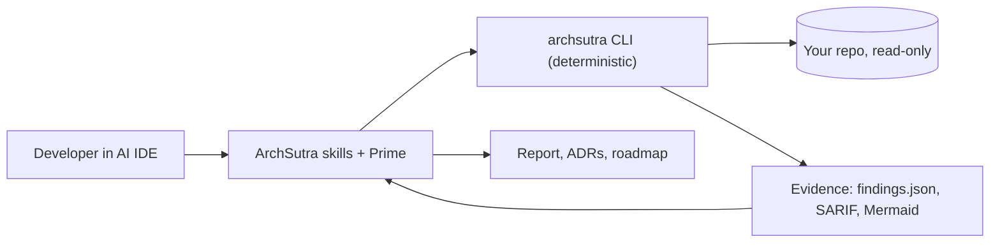

<div align="center">

# ArchSutra AI

### Software architecture agent for Claude Code, Cursor, Codex, GitHub Copilot & Gemini CLI

**Design. Audit. Evolve.** Evidence-first architecture review with `file:line` proof. No extra API key.

[](https://github.com/shahvatsalofficial/archsutra-ai/actions/workflows/ci.yml)
[](https://github.com/shahvatsalofficial/archsutra-ai/actions/workflows/codeql.yml)
[](LICENSE)


[**Documentation site**](https://shahvatsalofficial.github.io/archsutra-ai/) &middot; [Handbook](docs/handbook/README.md) &middot; [Proof and test results](docs/handbook/08-testing-and-proof.md) &middot; [Sample report](examples/brownfield-monolith/sample-output/audit-report.md)

</div>

---

ArchSutra AI is an open-source **software architecture agent**. It ships portable [Agent Skills](https://agentskills.io/specification), twelve specialist agent roles led by **ArchSutra Prime**, and a **deterministic, offline CLI** that maps a repository, audits it, and exports Markdown, Mermaid, JSON and SARIF reports.

> **No extra API key.** Inside a supported AI IDE, ArchSutra uses that IDE's own model. You need access to the IDE, not to an ArchSutra account. The CLI is offline, read-only by default, and has no telemetry. Optional provider-backed server inference is **not** part of v0.1; if added later it will be opt-in, separately configured, and may cost money.

Created by **[Vatsal Shah](https://github.com/shahvatsalofficial)**. Licensed under Apache-2.0.

## Contents

[Why](#why-archsutra-ai) &middot; [60-second start](#60-second-start) &middot; [What you get](#what-you-get) &middot; [Proof](#proof-not-promises) &middot; [Sample output](#sample-output) &middot; [Supported IDEs](#supported-ai-ides) &middot; [Agents](#the-agent-team) &middot; [CLI](#cli-reference) &middot; [CI](#use-it-in-ci) &middot; [How it works](#how-it-works) &middot; [Security](#security-and-privacy) &middot; [Legal](#legal-and-trademarks) &middot; [Limitations](#limitations) &middot; [FAQ](#faq) &middot; [Roadmap](#roadmap) &middot; [Contribute](#contributing)

## Why ArchSutra AI

| Problem | What ArchSutra does |
|---|---|
| AI reviews invent components and cite nothing | Every claim is tagged `observed` / `inferred` / `proposed` / `unknown`; observed claims cite `file:line` |
| Different answer every run | A deterministic CLI produces reproducible findings with stable rule IDs |
| Another tool, another key, another bill | Offline CLI; skills run on the model you already use in your IDE |
| Reviews are slow and rare | First-pass audit in seconds; fits in CI with `--fail-on high` |
| "Trust me" scanners | Open source, zero runtime dependencies, tests, CI on 3 OSes, labeled-fixture evaluation, documented limits |

## 60-second start

Requires Node.js 20+.

```bash
# audit any repo: read-only, offline, no API key
npx github:shahvatsalofficial/archsutra-ai audit .

# install the skills into your project for your AI IDE (preview first)
npx github:shahvatsalofficial/archsutra-ai install --host claude --target . --dry-run
npx github:shahvatsalofficial/archsutra-ai install --host claude --target .
```

Then ask your assistant:

> ArchSutra Prime: audit this repository's architecture. Establish what the code actually does first, then give findings with file and line evidence, severity and confidence, prioritized fixes, ADR recommendations and a phased roadmap. Stay read-only and label unknowns.

Write the full report set:

```bash
npx github:shahvatsalofficial/archsutra-ai export . --output docs/architecture
```

## What you get

| Capability | How | Needs an AI model? |
|---|---|---|
| Architecture audit: severity, confidence, `file:line` evidence | `archsutra audit` + `architecture-audit` skill | CLI no; skill yes (your IDE) |
| Reverse-engineer modules, dependencies, import cycles | `archsutra map` | No |
| Secrets, injection, TLS, container, IaC, supply-chain checks (redacted) | `archsutra audit` (19 rules) | No |
| C4-style context and module diagrams (Mermaid) | `archsutra export` | No |
| SARIF 2.1.0 for GitHub code scanning | `archsutra export` | No |
| Greenfield design, options, ADRs, roadmap | `architecture-design` skill | Yes (your IDE) |
| Threat modeling: STRIDE plus LLM and agent threats | `threat-modeling` skill | Yes (your IDE) |
| Monolith-to-services and cloud migration planning | `architecture-modernization` skill | Yes (your IDE) |
| Validate skills, links, diagrams, findings schema | `archsutra verify` | No |
| Safe, reversible install into 5 AI IDEs | `archsutra install` / `uninstall` | No |

## Proof, not promises

Everything below is reproducible from a clean clone. Full details: [Testing and proof](docs/handbook/08-testing-and-proof.md).

| Evidence | Result |
|---|---|
| Automated tests (`npm test`) | **20 passed, 0 failed** ([captured output](docs/proof/test-results.txt)) |
| CI matrix | Ubuntu, Windows, macOS x Node 20, 22: **6/6 jobs passed** ([Actions](https://github.com/shahvatsalofficial/archsutra-ai/actions)) |
| Labeled fixtures | 12/12 seeded rules found, 0 false positives on the clean fixture ([results](docs/proof/eval-results.json)) |
| Self-audit | CI audits this repository with `--fail-on high` |
| Runtime dependencies | **0** (CI enforces it) |
| Static analysis | CodeQL on every push; Dependabot enabled |

**Read the fine print.** The fixtures were written by the rule author, so 100% precision and recall is a *regression guarantee*, not a real-world accuracy figure. Real repositories will produce false positives and false negatives; every finding lists its caveats. A first CI run also failed on Node 20 and was fixed; that history is in the commit log.

**Not yet proven:** live behavior inside each AI IDE (adapters write the documented layouts but have not been smoke-tested in the live hosts), accuracy on real-world repositories, and trademark clearance for the name.

## Sample output

Abridged real output from the [`brownfield-monolith` fixture](fixtures/brownfield-monolith) ([full report](examples/brownfield-monolith/sample-output/audit-report.md)):

```text
Findings: 12 (critical 0, high 3, medium 7, low 2)

AS-SEC-004  high    Dynamic code or shell execution            src/services/user.ts:3
AS-SEC-005  high    SQL built by string interpolation          src/services/user.ts:2
AS-SEC-006  high    TLS certificate verification disabled      src/services/http.ts:2
AS-ARC-001  medium  Circular dependency (src/api <-> src/db)   src/api/routes.ts:1
AS-ARC-002  medium  Lower layer depends on a higher layer      src/db/repo.ts:1
AS-OPS-003  medium  Container runs as root                     Dockerfile:1
AS-SUP-001  medium  Dependency manifest without lockfile       package.json
AS-SUP-002  medium  Unpinned dependency range (latest)         package.json
...
Scorecard: Security weak, Maintainability adequate; Reliability, Performance,
Scalability, Data integrity, Cost: not assessed (needs runtime evidence)
```

Also generated: [`findings.json`](examples/brownfield-monolith/sample-output/findings.json) (schema v1.0.0), [`findings.sarif`](examples/brownfield-monolith/sample-output/findings.sarif), [`current-state.md`](examples/brownfield-monolith/sample-output/current-state.md) with Mermaid diagrams.

Every finding carries: stable ID, severity, confidence, evidence (`observed` / `inferred` / `unknown`), impact, why it matters, fix, verification, acceptance criteria, owner type, effort, caveats and references. Schema: [`schemas/findings.schema.json`](schemas/findings.schema.json).

## Supported AI IDEs

Support levels are stated plainly. **adapter** means ArchSutra writes the files in the layout the vendor documents; it has **not** been smoke-tested inside each live host yet.

| Host | Level | Skills location | Sub-agents | Notes |
|---|---|---|---|---|
| Claude Code | adapter | `.claude/skills/` | `.claude/agents/` (read-only tools) | |
| Cursor | adapter | `.cursor/skills/` | no | skills only |
| OpenAI Codex | adapter | `.agents/skills/` | no | adds a managed block to `AGENTS.md` |
| GitHub Copilot | adapter | `.github/skills/` | `.github/agents/*.agent.md` | only `description` and `tools` frontmatter written |
| Gemini CLI | experimental | `.gemini/skills/` | no | layout unconfirmed for the current release |

Details: [compatibility matrix](docs/compatibility/matrix.md). Installs are idempotent and reversible: files you edited are never overwritten without `--force` (originals are backed up), and `uninstall` removes only files it installed and you did not modify. Have a host? Please file a [smoke test report](https://github.com/shahvatsalofficial/archsutra-ai/issues/new?template=smoke_test.md).

## The agent team

| Agent | Focus |
|---|---|
| [Prime](agents/prime.md) | Orchestrator: scoping, delegation, synthesis |
| [Atlas](agents/atlas.md) | Enterprise and solution architecture, bounded contexts |
| [Blueprint](agents/blueprint.md) | C4, HLD/LLD, ADRs, diagrams |
| [Sentinel](agents/sentinel.md) | Security, STRIDE, OWASP, privacy |
| [Cloud](agents/cloud.md) | Cloud/hybrid topology, IaC, DR |
| [Data](agents/data.md) | Data models, consistency, migrations |
| [Nexus](agents/nexus.md) | APIs, events, integration contracts |
| [Neural](agents/neural.md) | LLM apps, RAG, agent safety |
| [Scale](agents/scale.md) | SLOs, capacity, reliability |
| [Ledger](agents/ledger.md) | Cost, FinOps, lock-in |
| [Forge](agents/forge.md) | Refactoring and migration task plans |
| [Verify](agents/verify.md) | Evidence integrity and quality gate |

Real sub-agent spawning depends on the host. Where unavailable, Prime performs the specialist reviews sequentially.

## CLI reference

```text
archsutra init|doctor|map|audit|verify|export [path]
archsutra install|uninstall --host <claude|cursor|codex|copilot|gemini> [--target dir] [--dry-run] [--force]
archsutra hosts
Flags: --json  --dry-run  --output <dir>  --fail-on <critical|high|medium|low>  --verbose  --version  --help
```

Exit codes: `0` ok, `1` findings at or above `--fail-on` / install conflict / failed doctor, `2` usage error, `3` command needs a model (use the skill), `4` verification failed, `5` internal error.

`design`, `review`, `threat-model`, `modernize`, `compare`, `cost` and `drift` need semantic reasoning, so the CLI exits `3` and points you to the matching skill. It never pretends a parser can reason and never calls a model API. Full reference: [CLI reference](docs/handbook/06-cli-reference.md). Rule list: [rule catalog](docs/handbook/12-rule-catalog.md).

## Use it in CI

```yaml
- run: npx --yes github:shahvatsalofficial/archsutra-ai audit . --fail-on high
```

Upload SARIF to GitHub code scanning: see the [user guide](docs/handbook/05-user-guide.md). Pin to a tag or commit in production pipelines.

## How it works



The deterministic CLI gathers reproducible evidence. The IDE's own model reasons over it through the skills. More: [architecture](docs/handbook/04-architecture.md), [technical specification](docs/handbook/03-technical-specification.md), [RFC](docs/rfc/0001-archsutra-v0.1.md).

## Security and privacy

- Read-only by default; no telemetry; no network calls; no code leaves your machine from the CLI.
- Secrets are detected and **redacted** before reaching any report or log.
- Repository content is treated as untrusted data (prompt-injection aware); agent profiles are read-only.
- Symlinks are never followed; scans are bounded by file count, size and time; all writes are path-contained.
- No claim of compliance or certification. Reports are review aids.

When you use the skills, **your AI IDE's model provider** processes your prompts and code under its own terms. Report vulnerabilities privately: see [SECURITY.md](SECURITY.md). Full analysis: [threat model](docs/architecture/threat-model.md), [security, privacy and legal](docs/handbook/07-security-privacy-legal.md).

## Legal and trademarks

- **License:** [Apache-2.0](LICENSE) (commercial use allowed; keep the license and [NOTICE](NOTICE)). Dependencies: none at runtime; see [third-party notices](THIRD_PARTY_NOTICES.md).
- **Not affiliated.** Claude, Claude Code, Anthropic, Cursor, OpenAI, Codex, GitHub, GitHub Copilot, Google and Gemini are trademarks of their owners and appear only to describe compatibility. This project is not affiliated with, endorsed by or sponsored by them.
- **Name.** "ArchSutra" has **not** been trademark-searched or registered. On 2026-10-31 the npm names `archsutra` and `archsutra-ai` were unclaimed and no other GitHub repository was named `archsutra`; that is a spot check, not legal clearance. Do a proper search before any commercial launch.
- **No warranty, no advice.** Provided "AS IS". Nothing here is legal, security or compliance advice, or a certification.
- **Authorized use only.** Run it on code you own or are permitted to review.

## Limitations

- Static, heuristic rules: expect false positives and false negatives; every finding lists caveats.
- Import graph covers JS/TS and Python. Other languages are detected but not graphed.
- Reliability, performance, scalability, data integrity and cost are `not assessed` without runtime evidence.
- Adapters are not yet verified in live hosts. Not published to npm (use the `npx github:` path).

## FAQ

**Do I need an API key?** No. The CLI is offline; the skills use your IDE's own model.

**Does it send my code anywhere?** The CLI sends nothing. Your IDE's model provider handles prompts when you use the skills.

**Which assistants work?** Claude Code, Cursor, Codex, Copilot (adapter), Gemini CLI (experimental). See the [matrix](docs/compatibility/matrix.md).

**Is it a replacement for SonarQube, Semgrep or CodeQL?** No; it complements them at the architecture level and emits SARIF so results can sit beside theirs.

**Does it certify compliance?** No. Never.

**Can I use it commercially?** Yes under Apache-2.0; clear the name first.

More: [glossary and FAQ](docs/handbook/11-glossary-and-faq.md).

## Roadmap

- [ ] Live smoke tests per AI IDE and published, versioned compatibility results
- [ ] More analyzers: Java/Kotlin, C#, Go, Rust import graphs
- [ ] Real-world labeled corpus and published accuracy
- [ ] Suppression/baseline file for accepted findings
- [ ] Optional local-model and bring-your-own-key server mode, strictly opt-in
- [ ] npm publication after name and trademark checks

Full plan with acceptance tests: [roadmap](docs/handbook/09-compatibility-and-roadmap.md).

## Contributing

Good first contributions: a new audit rule, a language import graph, a fixture repository, a host smoke-test report, an agent specialization. Start with [CONTRIBUTING.md](CONTRIBUTING.md) and the [contributor guide](docs/handbook/10-contributor-guide.md). Be kind: [Code of Conduct](CODE_OF_CONDUCT.md).

## Develop

```bash
git clone https://github.com/shahvatsalofficial/archsutra-ai
cd archsutra-ai
npm ci
npm test
node scripts/eval.mjs
node dist/cli.js audit .
node scripts/build-docs.mjs   # regenerate the HTML documentation site
```

## Cite

See [CITATION.cff](CITATION.cff).

## Keywords

software architecture, architecture review, architecture audit, AI architect agent, Claude Code skills, Cursor skills, Codex skills, GitHub Copilot custom agents, Gemini CLI, Agent Skills, SKILL.md, C4 model, ADR, threat modeling, STRIDE, OWASP, Mermaid diagrams, SARIF, technical debt, LLM agent safety, prompt injection, offline CLI, no API key.

---

Copyright 2026 Vatsal Shah and contributors. Licensed under the [Apache License 2.0](LICENSE).
