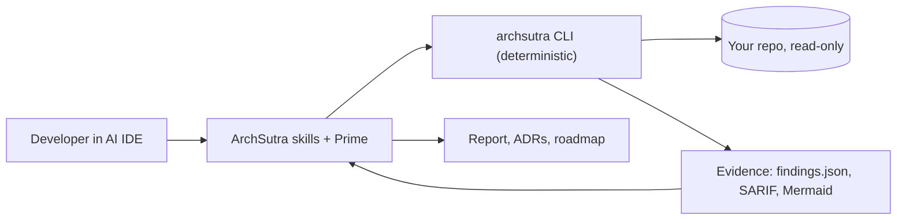

<div align="center">

# ArchSutra AI

### Software architecture agent for Claude Code, Cursor, Codex, GitHub Copilot & Gemini CLI

**Design. Audit. Evolve.** Evidence-first architecture review with `file:line` proof. No extra API key.

[](https://github.com/shahvatsalofficial/archsutra-ai/actions/workflows/ci.yml)
[](https://github.com/shahvatsalofficial/archsutra-ai/actions/workflows/codeql.yml)
[](LICENSE)


[**Documentation site**](https://shahvatsalofficial.github.io/archsutra-ai/) &middot; [Handbook](docs/handbook/README.md) &middot; [**Trust and assurance register**](docs/handbook/13-trust-and-assurance.md) &middot; [Real-world evaluation](docs/handbook/14-real-world-evaluation.md) &middot; [Sample report](examples/brownfield-monolith/sample-output/audit-report.md)

</div>

---

ArchSutra AI is an open-source **software architecture agent**. It ships portable [Agent Skills](https://agentskills.io/specification), twelve specialist agent roles led by **ArchSutra Prime**, and a **deterministic, offline CLI** that maps a repository, audits it, and exports Markdown, Mermaid, JSON and SARIF reports.

> **No extra API key.** Inside a supported AI IDE, ArchSutra uses that IDE's own model. You need access to the IDE, not to an ArchSutra account. The CLI is offline, read-only by default, and has no telemetry. Optional provider-backed server inference is **not** part of v0.1; if added later it will be opt-in, separately configured, and may cost money.

Created by **[Vatsal Shah](https://github.com/shahvatsalofficial)**. Licensed under Apache-2.0.

## Contents

[Why](#why-archsutra-ai) &middot; [60-second start](#60-second-start) &middot; [What you get](#what-you-get) &middot; [Proof](#proof-not-promises) &middot; [Sample output](#sample-output) &middot; [Supported IDEs](#supported-ai-ides) &middot; [Agents](#the-agent-team) &middot; [CLI](#cli-reference) &middot; [CI](#use-it-in-ci) &middot; [How it works](#how-it-works) &middot; [Security](#security-and-privacy) &middot; [Legal](#legal-and-trademarks) &middot; [Limitations](#limitations) &middot; [FAQ](#faq) &middot; [Roadmap](#roadmap) &middot; [Contribute](#contributing)

## Why ArchSutra AI

| Problem | What ArchSutra does |
|---|---|
| AI reviews invent components and cite nothing | Every claim is tagged `observed` / `inferred` / `proposed` / `unknown`; observed claims cite `file:line` |
| Different answer every run | A deterministic CLI produces reproducible findings with stable rule IDs |
| Another tool, another key, another bill | Offline CLI; skills run on the model you already use in your IDE |
| Reviews are slow and rare | First-pass audit in seconds; fits in CI with `--fail-on high` |
| "Trust me" scanners | Open source, zero runtime dependencies, tests, CI on 3 OSes, accuracy measured on 52 real repositories with the false positives published |

## 60-second start

Requires Node.js 20+.

```bash
# audit any repo: read-only, offline, no API key
npx github:shahvatsalofficial/archsutra-ai audit .

# install the skills into your project for your AI IDE (preview first)
npx github:shahvatsalofficial/archsutra-ai install --host claude --target . --dry-run
npx github:shahvatsalofficial/archsutra-ai install --host claude --target .
```

For anything beyond a first try, **pin a tag or commit** so the code cannot change under you: `npx github:shahvatsalofficial/archsutra-ai#v0.1.1 audit .` (see [supply chain](docs/handbook/15-supply-chain-and-release.md)). Install **one** host per project; several hosts read the same skill folders.

Then ask your assistant:

> ArchSutra Prime: audit this repository's architecture. Establish what the code actually does first, then give findings with file and line evidence, severity and confidence, prioritized fixes, ADR recommendations and a phased roadmap. Stay read-only and label unknowns.

Write the full report set:

```bash
npx github:shahvatsalofficial/archsutra-ai export . --output docs/architecture
```

## What you get

| Capability | How | Needs an AI model? |
|---|---|---|
| Architecture audit: severity, confidence, `file:line` evidence | `archsutra audit` + `architecture-audit` skill | CLI no; skill yes (your IDE) |
| Reverse-engineer modules, dependencies, import cycles | `archsutra map` | No |
| Secrets, injection, TLS, container, IaC, supply-chain checks (redacted) | `archsutra audit` (19 rules) | No |
| C4-style context and module diagrams (Mermaid) | `archsutra export` | No |
| SARIF 2.1.0 for GitHub code scanning | `archsutra export` | No |
| Greenfield design, options, ADRs, roadmap | `architecture-design` skill | Yes (your IDE) |
| Threat modeling: STRIDE plus LLM and agent threats | `threat-modeling` skill | Yes (your IDE) |
| Monolith-to-services and cloud migration planning | `architecture-modernization` skill | Yes (your IDE) |
| Validate skills, links, diagrams, findings schema | `archsutra verify` | No |
| Safe, reversible install into 5 AI IDEs | `archsutra install` / `uninstall` | No |

## Proof, not promises

Everything below is reproducible from a clean clone. The full, honest register of what is proven and what is still open: **[Trust and assurance](docs/handbook/13-trust-and-assurance.md)**.

### Accuracy on real code (the number that matters)

The tool was run on **52 public repositories** (Express, Django, Flask, Vue, webpack, Juice Shop, WebGoat, ...). **98 findings were labeled by hand** by reading the cited code. Results by batch:

| Batch | When | Precision (95% CI) | Actionable (95% CI) |
|---|---|---|---|
| Baseline, v0.1.0 | before any fix | **50%** (36 to 64), n=48 | 29% (18 to 43) |
| Unseen batch 1 | after round-1 fixes | **69%** (51 to 83), n=29 | 34% (20 to 53) |
| Unseen batch 2 | after round-2 fixes | **95%** (77 to 99), n=21 | 52% (32 to 72) |

*Precision* = the code really is what the rule says. *Actionable* = a maintainer would plausibly change something. **About half of valid findings need no action** (for example intentional `eval`, a test key, a dev container).

We published the 50% baseline, fixed the false positives it exposed (each has a regression test), then re-measured on repositories never used for tuning. **Limits:** one labeler (an AI model reading each line, labels are public and challengeable), small samples with wide intervals, recall not measured on real code, and some of the improvement comes from fixes designed on earlier batches. Details, method, every label: [Real-world evaluation](docs/handbook/14-real-world-evaluation.md).

### Other evidence

| Evidence | Result |
|---|---|
| Automated tests (`npm test`) | **28 passed, 0 failed** ([output](docs/proof/test-results.txt)) |
| Test coverage | 91% lines, 80% branches, 90% functions ([report](docs/proof/coverage.txt)) |
| CI matrix | Ubuntu, Windows, macOS x Node 20, 22: all 6 jobs passed on the v0.1.0 commit ([Actions](https://github.com/shahvatsalofficial/archsutra-ai/actions)); confirm the latest run there |
| Robustness | ReDoS guard, hostile file names, binary files, path traversal, symlinks, byte and file budgets, all tested |
| Performance | median 1.2 s per real repository; bounded by file, size, byte and time limits ([benchmarks](docs/proof/benchmarks.md)) |
| Accessibility of the docs site | axe-core: 0 violations over 19 pages x 2 themes; 22 contrast checks pass ([audit](docs/proof/accessibility.md)); no screen-reader test yet |
| Supply chain | 0 runtime dependencies; all GitHub Actions pinned to SHAs; CodeQL; SBOM, checksums and signed provenance on each tagged release ([details](docs/handbook/15-supply-chain-and-release.md)) |
| Self-audit | the tool audits its own repository in CI with `--fail-on high` and reports nothing |

### Not yet proven (we say so)

Live behavior inside each AI IDE (layouts match vendor docs; [smoke-test protocol](docs/compatibility/smoke-tests/README.md) is open for results), an independent security review, a head-to-head comparison with other scanners (workflow ready, not yet run), trademark clearance for the name, and a lawyer's review of these documents. No OpenSSF Scorecard result exists until the first run; none is quoted.

## Sample output

Abridged real output from the [`brownfield-monolith` fixture](fixtures/brownfield-monolith) ([full report](examples/brownfield-monolith/sample-output/audit-report.md)):

```text
Findings: 12 (critical 0, high 3, medium 7, low 2)

AS-SEC-004  high    Dynamic code or shell execution            src/services/user.ts:3
AS-SEC-005  high    SQL built by string interpolation          src/services/user.ts:2
AS-SEC-006  high    TLS certificate verification disabled      src/services/http.ts:2
AS-ARC-001  medium  Circular dependency (src/api <-> src/db)   src/api/routes.ts:1
AS-ARC-002  medium  Lower layer depends on a higher layer      src/db/repo.ts:1
AS-OPS-003  medium  Container runs as root                     Dockerfile:1
AS-SUP-001  medium  Dependency manifest without lockfile       package.json
AS-SUP-002  medium  Unpinned dependency range (latest)         package.json
...
Scorecard: Security weak, Maintainability adequate; Reliability, Performance,
Scalability, Data integrity, Cost: not assessed (needs runtime evidence)
```

Also generated: [`findings.json`](examples/brownfield-monolith/sample-output/findings.json) (schema v1.0.0), [`findings.sarif`](examples/brownfield-monolith/sample-output/findings.sarif), [`current-state.md`](examples/brownfield-monolith/sample-output/current-state.md) with Mermaid diagrams.

Every finding carries: stable ID, severity, confidence, evidence (`observed` / `inferred` / `unknown`), impact, why it matters, fix, verification, acceptance criteria, owner type, effort, caveats and references. Schema: [`schemas/findings.schema.json`](schemas/findings.schema.json).

## Supported AI IDEs

Support levels are stated plainly. **adapter** means ArchSutra writes the files in the layout the vendor documents (checked against the vendors' docs on 2026-11-01); it has **not** been smoke-tested inside each live host yet.

| Host | Level | Skills location | Sub-agents | Notes |
|---|---|---|---|---|
| Claude Code | adapter | `.claude/skills/` | `.claude/agents/` (read-only tools) | |
| Cursor | adapter | `.cursor/skills/` | `.cursor/agents/` (`readonly: true`) | also reads `.agents/skills`, `.claude/skills` |
| OpenAI Codex | adapter | `.agents/skills/` | no | adds a managed block to `AGENTS.md` |
| GitHub Copilot | adapter | `.github/skills/` | `.github/agents/*.agent.md` | only `description` and `tools` frontmatter written |
| Gemini CLI | adapter | `.gemini/skills/` | no | docs announce Antigravity CLI as successor; re-verify |

Details: [compatibility matrix](docs/compatibility/matrix.md). Installs are idempotent and reversible: files you edited are never overwritten without `--force` (originals are backed up), and `uninstall` removes only files it installed and you did not modify. Have a host? Please run the [smoke test](docs/compatibility/smoke-tests/README.md) and report.

## The agent team

| Agent | Focus |
|---|---|
| [Prime](agents/prime.md) | Orchestrator: scoping, delegation, synthesis |
| [Atlas](agents/atlas.md) | Enterprise and solution architecture, bounded contexts |
| [Blueprint](agents/blueprint.md) | C4, HLD/LLD, ADRs, diagrams |
| [Sentinel](agents/sentinel.md) | Security, STRIDE, OWASP, privacy |
| [Cloud](agents/cloud.md) | Cloud/hybrid topology, IaC, DR |
| [Data](agents/data.md) | Data models, consistency, migrations |
| [Nexus](agents/nexus.md) | APIs, events, integration contracts |
| [Neural](agents/neural.md) | LLM apps, RAG, agent safety |
| [Scale](agents/scale.md) | SLOs, capacity, reliability |
| [Ledger](agents/ledger.md) | Cost, FinOps, lock-in |
| [Forge](agents/forge.md) | Refactoring and migration task plans |
| [Verify](agents/verify.md) | Evidence integrity and quality gate |

Real sub-agent spawning depends on the host. Where unavailable, Prime performs the specialist reviews sequentially.

## CLI reference

```text
archsutra init|doctor|map|audit|verify|export [path]
archsutra install|uninstall --host <claude|cursor|codex|copilot|gemini> [--target dir] [--dry-run] [--force]
archsutra hosts
Flags: --json  --dry-run  --output <dir>  --fail-on <critical|high|medium|low>  --verbose  --version  --help
```

Exit codes: `0` ok, `1` findings at or above `--fail-on` / install conflict / failed doctor, `2` usage error, `3` command needs a model (use the skill), `4` verification failed, `5` internal error.

`design`, `review`, `threat-model`, `modernize`, `compare`, `cost` and `drift` need semantic reasoning, so the CLI exits `3` and points you to the matching skill. It never pretends a parser can reason and never calls a model API. Full reference: [CLI reference](docs/handbook/06-cli-reference.md). Rule list: [rule catalog](docs/handbook/12-rule-catalog.md).

## Use it in CI

```yaml
- run: npx --yes github:shahvatsalofficial/archsutra-ai#v0.1.1 audit . --fail-on high
```

Upload SARIF to GitHub code scanning: see the [user guide](docs/handbook/05-user-guide.md). Start with `--fail-on critical` on an existing codebase and tighten later; roughly half of valid findings need no action.

## How it works



The deterministic CLI gathers reproducible evidence. The IDE's own model reasons over it through the skills. More: [architecture](docs/handbook/04-architecture.md), [technical specification](docs/handbook/03-technical-specification.md), [RFC](docs/rfc/0001-archsutra-v0.1.md).

## Security and privacy

- Read-only by default; no telemetry; no network calls; no code leaves your machine from the CLI.
- Secrets are detected and **redacted** before reaching any report or log.
- Repository content is treated as untrusted data (prompt-injection aware); agent profiles are read-only.
- Symlinks are never followed; scans are bounded by file count, size, total bytes and time; all writes are path-contained.
- No claim of compliance or certification. Reports are review aids.

When you use the skills, **your AI IDE's model provider** processes your prompts and code under its own terms. Report vulnerabilities privately: see [SECURITY.md](SECURITY.md). **No independent security review has been done; one is welcome.** Full analysis: [threat model](docs/architecture/threat-model.md), [security, privacy and legal](docs/handbook/07-security-privacy-legal.md).

## Legal and trademarks

- **License:** [Apache-2.0](LICENSE) (commercial use allowed; keep the license and [NOTICE](NOTICE)). Dependencies: none at runtime; see [third-party notices](THIRD_PARTY_NOTICES.md). Contributions use the [DCO](DCO.md), no CLA.
- **Not affiliated.** Claude, Claude Code, Anthropic, Cursor, OpenAI, Codex, GitHub, GitHub Copilot, Google and Gemini are trademarks of their owners and appear only to describe compatibility. This project is not affiliated with, endorsed by or sponsored by them.
- **Name.** "ArchSutra" has **not** been trademark-searched by a professional or registered. Informal checks (npm, GitHub, web search) found no conflict on 2026-10-31 and 2026-11-01; that is not legal clearance. See [name clearance](docs/legal/trademark-and-name-clearance.md). Do a proper search before any commercial launch.
- **Documents not yet reviewed by a lawyer.** A [review brief](docs/legal/legal-review-brief.md) is ready.
- **No warranty, no advice.** Provided "AS IS". Nothing here is legal, security or compliance advice, or a certification.
- **Authorized use only.** Run it on code you own or are permitted to review.

## Limitations

- Static, heuristic rules: expect false positives and false negatives; every finding lists caveats, and about half of valid findings are not worth acting on.
- Import graph covers JS/TS and Python. Other languages are detected but not graphed.
- Reliability, performance, scalability, data integrity and cost are `not assessed` without runtime evidence.
- Adapters are not yet verified in live hosts. Not published to npm (use the `npx github:` path).

## FAQ

**Do I need an API key?** No. The CLI is offline; the skills use your IDE's own model.

**Does it send my code anywhere?** The CLI sends nothing. Your IDE's model provider handles prompts when you use the skills.

**How accurate is it?** On unseen real repositories 69% and 95% of sampled findings were genuine instances (small samples, one labeler); about half were worth acting on. See [the evaluation](docs/handbook/14-real-world-evaluation.md).

**Which assistants work?** Claude Code, Cursor, Codex, Copilot, Gemini CLI at adapter level. See the [matrix](docs/compatibility/matrix.md).

**Is it a replacement for SonarQube, Semgrep or CodeQL?** No; it complements them at the architecture level and emits SARIF so results can sit beside theirs.

**Does it certify compliance?** No. Never.

**Can I use it commercially?** Yes under Apache-2.0; clear the name first.

More: [glossary and FAQ](docs/handbook/11-glossary-and-faq.md).

## Roadmap

- [ ] Live smoke tests per AI IDE ([protocol](docs/compatibility/smoke-tests/README.md))
- [ ] First run of the tool comparison workflow, results reviewed and published
- [ ] Larger, multi-labeler evaluation corpus and a recall estimate
- [ ] More analyzers: Java/Kotlin, C#, Go, Rust import graphs
- [ ] Suppression/baseline file for accepted findings
- [ ] Independent security review; trademark clearance; legal review
- [ ] Optional local-model and bring-your-own-key server mode, strictly opt-in
- [ ] npm publication after name and trademark checks

Full plan with acceptance tests: [roadmap](docs/handbook/09-compatibility-and-roadmap.md). Starter tasks: [good first issues](docs/community/good-first-issues.md).

## Contributing

Good first contributions: a host smoke-test report, a false-positive report, a new audit rule, a language import graph, a fixture repository, labeled findings. Start with [CONTRIBUTING.md](CONTRIBUTING.md) and the [contributor guide](docs/handbook/10-contributor-guide.md). Sign off commits (`git commit -s`, see [DCO](DCO.md)). Be kind: [Code of Conduct](CODE_OF_CONDUCT.md). Governance: [GOVERNANCE.md](GOVERNANCE.md). Help: [SUPPORT.md](SUPPORT.md).

## Develop

```bash
git clone https://github.com/shahvatsalofficial/archsutra-ai
cd archsutra-ai
npm ci
npm test
npm run coverage
node scripts/eval.mjs
node dist/cli.js audit .
node scripts/build-docs.mjs   # regenerate the HTML documentation site
```

## Cite

See [CITATION.cff](CITATION.cff).

## Keywords

software architecture, architecture review, architecture audit, AI architect agent, Claude Code skills, Cursor skills, Codex skills, GitHub Copilot custom agents, Gemini CLI, Agent Skills, SKILL.md, C4 model, ADR, threat modeling, STRIDE, OWASP, Mermaid diagrams, SARIF, technical debt, LLM agent safety, prompt injection, offline CLI, no API key.

---

Copyright 2026 Vatsal Shah and contributors. Licensed under the [Apache License 2.0](LICENSE).
