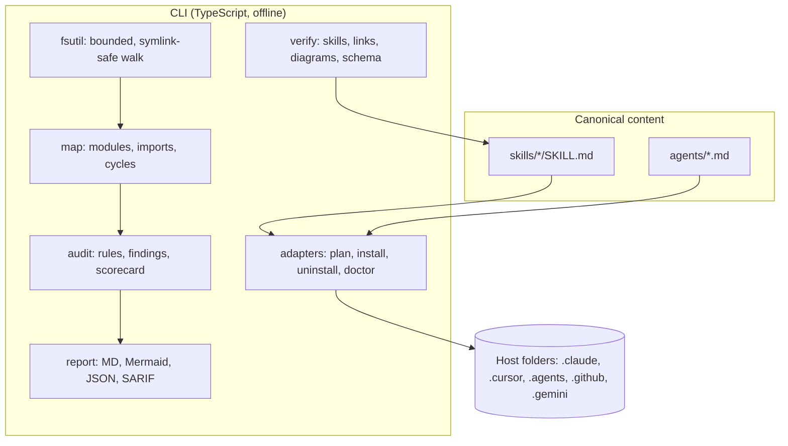

# Architecture overview

ArchSutra has two cooperating halves:

1. **Skills and agents** (`skills/`, `agents/`): canonical Markdown that an AI IDE loads. Reasoning runs on the IDE's own model.
2. **Deterministic CLI** (`src/`): produces reproducible evidence without any model.

## Module responsibilities

| Module | Responsibility |
|---|---|
| `src/fsutil.ts` | file walk with limits (5000 files, 512 KB each, 15 s), ignore lists, symlink skipping, path containment |
| `src/redact.ts` | secret detection and masking; used for every excerpt |
| `src/map.ts` | ecosystems, frameworks, datastores, infra, module graph, Tarjan cycle detection |
| `src/audit.ts` | rules to findings with evidence; scorecard with `not assessed` where evidence is absent |
| `src/report.ts` | Markdown, Mermaid, findings JSON (v1.0.0), SARIF 2.1.0, artifact register |
| `src/verify.ts` | structural validation of skills, agents, links, Mermaid, findings |
| `src/adapters.ts` | host specs, install plan with conflict detection, hash manifest, uninstall, doctor |
| `src/cli.ts` | argument parsing, exit codes, command dispatch |

## Key decisions

See [../decisions/](../decisions/).
