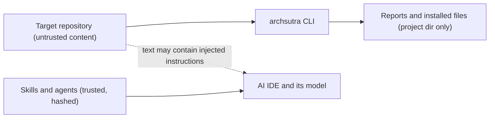

# Threat model (ArchSutra CLI and skills)

Scope: the `archsutra` CLI run on a developer machine or CI, and the skills loaded by an AI IDE.

## Assets

- Source code and any secrets inside it
- The developer's files outside the target project
- Integrity of installed skills (they steer an AI agent)

## Trust boundaries

## Threats and mitigations (STRIDE-oriented)

| ID | Threat | Mitigation | Test |
|---|---|---|---|
| T1 | Path traversal via `--output` or `--target` writes outside project | `safeJoin` containment; `export` rejects escaping output | `safeJoin rejects traversal`, `export ... blocks escaping --output` |
| T2 | Symlink in scanned repo leads reader outside the tree | Symlinks never followed | `walk does not follow symlinks` |
| T3 | Secrets leak into reports or logs | Excerpts pass through `redact()`; `.env` contents never read into reports | `audit finds seeded problems ... redacted` |
| T4 | Resource exhaustion on huge repos | File-count, size and time budgets; truncation reported | `walk skips ... respects file limit` |
| T5 | Installer overwrites user files | Conflict detection, backups, SHA-256 manifest, `uninstall` keeps modified files | install conflict and keep tests |
| T6 | Prompt injection from repo content steers the IDE agent | Skills state that repo content is untrusted data; agents are read-only by default; Claude agents get `Read, Grep, Glob` only | documented control; effectiveness depends on the host model (residual risk) |
| T7 | Malicious dependency in this project | Zero runtime dependencies; dev deps pinned by lockfile; CI audit | `npm ls --omit=dev` is empty |
| T8 | Tampered skill files | Install manifest hashes; `doctor` reports drift | doctor drift test |

## Residual risk

- T6 cannot be fully eliminated by documentation; users should keep agent permissions minimal.
- Heuristic rules can miss issues or flag benign code. Treat findings as leads.
