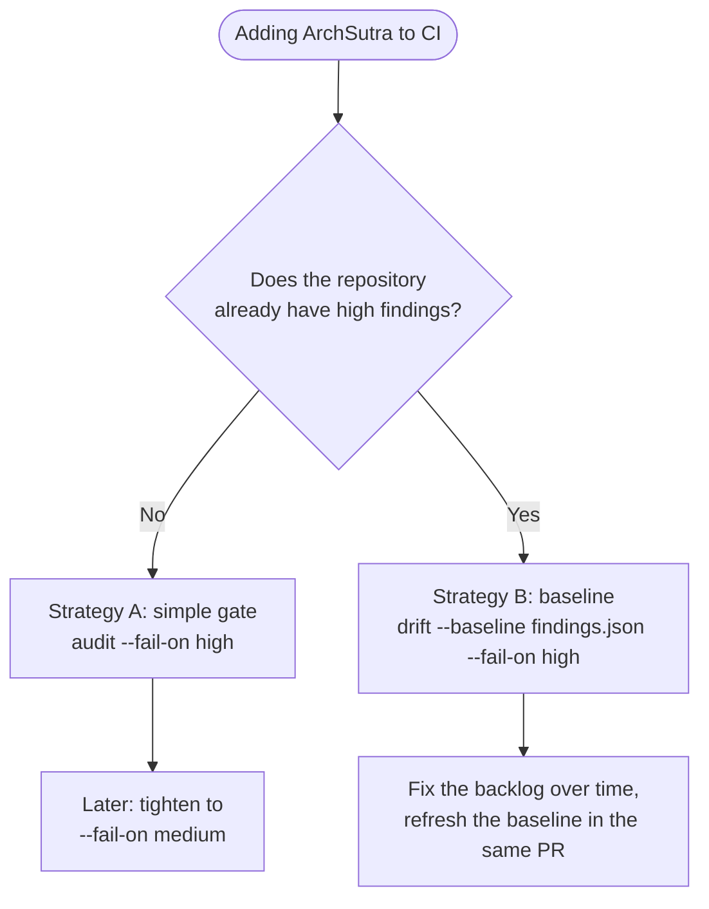
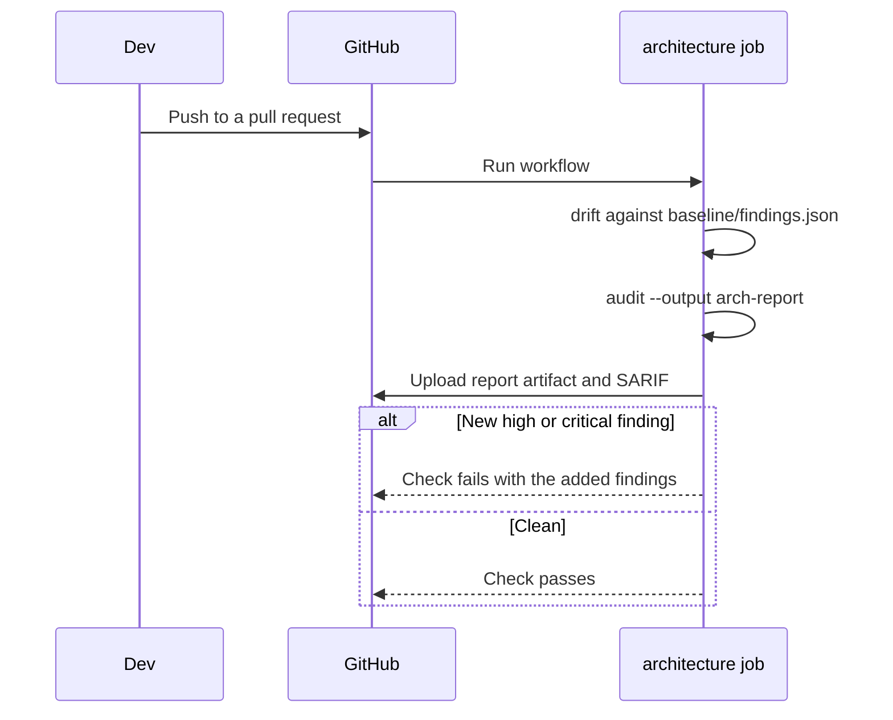

# CI recipes

<!-- summary: Copy-paste setups for GitHub Actions, GitLab CI, pre-commit and generic pipelines: a simple gate, a baseline for legacy code, SARIF upload, and report artifacts. -->

ArchSutra's CLI is offline and deterministic, so it fits any pipeline: it needs only Node.js 20 or newer, no secrets and no network access to your code.

## Choose a strategy



| Strategy | Fails when | Best for |
|---|---|---|
| A. Simple gate | the repository has any finding at or above the level | new or clean projects |
| B. Baseline | a pull request **adds** a finding at or above the level | legacy codebases you are improving |

## GitHub Actions: simple gate

```yaml
name: architecture
on: [pull_request]
permissions:
  contents: read
jobs:
  audit:
    runs-on: ubuntu-latest
    steps:
      - uses: actions/checkout@v4
      - uses: actions/setup-node@v4
        with: { node-version: 22 }
      - run: npx --yes archsutra-ai@0.1.5 audit . --fail-on high
```

> **Tip.** Pin the version (`@0.1.5`) so a new release cannot change your build overnight, and pin the actions to commit SHAs in production pipelines.

## GitHub Actions: baseline, report artifact and code-scanning upload

```yaml
name: architecture
on: [pull_request]
permissions:
  contents: read
  security-events: write
jobs:
  audit:
    runs-on: ubuntu-latest
    steps:
      - uses: actions/checkout@v4
      - uses: actions/setup-node@v4
        with: { node-version: 22 }

      # Strategy B: fail only on NEW high or critical findings
      - run: npx --yes archsutra-ai@0.1.5 drift . --baseline baseline/findings.json --fail-on high

      # Always produce the readable report, even when the gate fails
      - if: always()
        run: npx --yes archsutra-ai@0.1.5 audit . --output arch-report
      - if: always()
        uses: actions/upload-artifact@v4
        with: { name: architecture-report, path: arch-report }

      # Show findings in the GitHub Security tab
      - if: always()
        uses: github/codeql-action/upload-sarif@v4
        with: { sarif_file: arch-report/findings.sarif }
```

The reviewer downloads `architecture-report`, opens `index.html`, and sees the same readable report you saw locally.



## Refresh the baseline (the ratchet)

When a pull request fixes findings, record the better state in the same pull request so the bar only moves up:

```bash
npx archsutra-ai audit . --json > baseline/findings.json
git add baseline/findings.json
```

`drift` also tells you what a change *removed*, which is a nice line for a pull-request description.

## GitLab CI

```yaml
architecture:
  image: node:22
  stage: test
  script:
    - npx --yes archsutra-ai@0.1.5 drift . --baseline baseline/findings.json --fail-on high
    - npx --yes archsutra-ai@0.1.5 audit . --output arch-report
  artifacts:
    when: always
    paths: [arch-report/]
```

## Pre-commit hook (local, fast)

```bash
#!/usr/bin/env sh
# .git/hooks/pre-commit  (chmod +x)
npx --yes archsutra-ai@0.1.5 audit . --fail-on critical >/dev/null || {
  echo "ArchSutra: critical finding. Run: npx archsutra-ai audit ." >&2
  exit 1
}
```

Use `critical` locally so the hook stays quiet unless a secret or committed private key slipped in; run the stricter gate in CI.

## Any other CI (Jenkins, Azure Pipelines, CircleCI)

The contract is three lines: have Node 20 or newer, run the command, treat a non-zero exit as failure.

```bash
node --version
npx --yes archsutra-ai@0.1.5 audit . --fail-on high
```

| Exit code | Meaning |
|---|---|
| `0` | Success, or no finding at or above `--fail-on` |
| `1` | A finding at or above `--fail-on` (for `drift`: an **added** one) or an install conflict |
| `2` | Usage error (unknown command, bad flag value) |
| `4` | `verify` found a problem |
| `5` | Internal error |

## Keep CI fast and safe

- **Time.** Typical repositories take well under 10 seconds; the scan is capped at 5 000 files, so a monorepo should be audited per package.
- **Secrets.** The CLI needs none and sends nothing anywhere.
- **Forks.** Because nothing is sent out, it is safe on pull requests from forks.
- **Pin.** Pin the package version and the actions.

## Next

- Understand what failed: [Reading and triaging a report](reading-a-report.md)
- See it in a story: [scenario 2](real-world-scenarios.md#2-stop-regressions-at-the-door)
