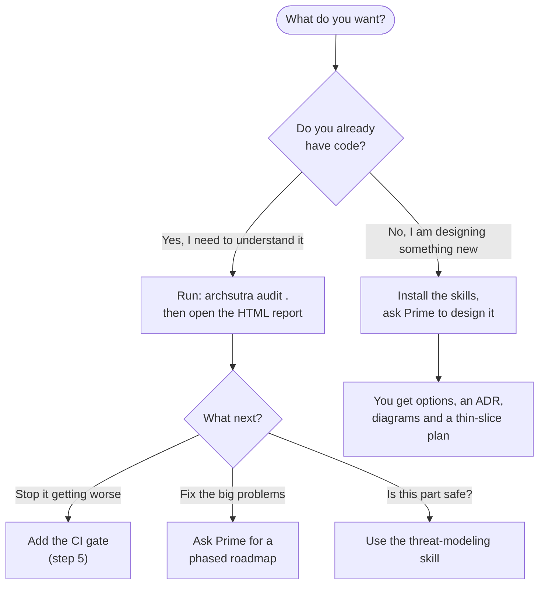
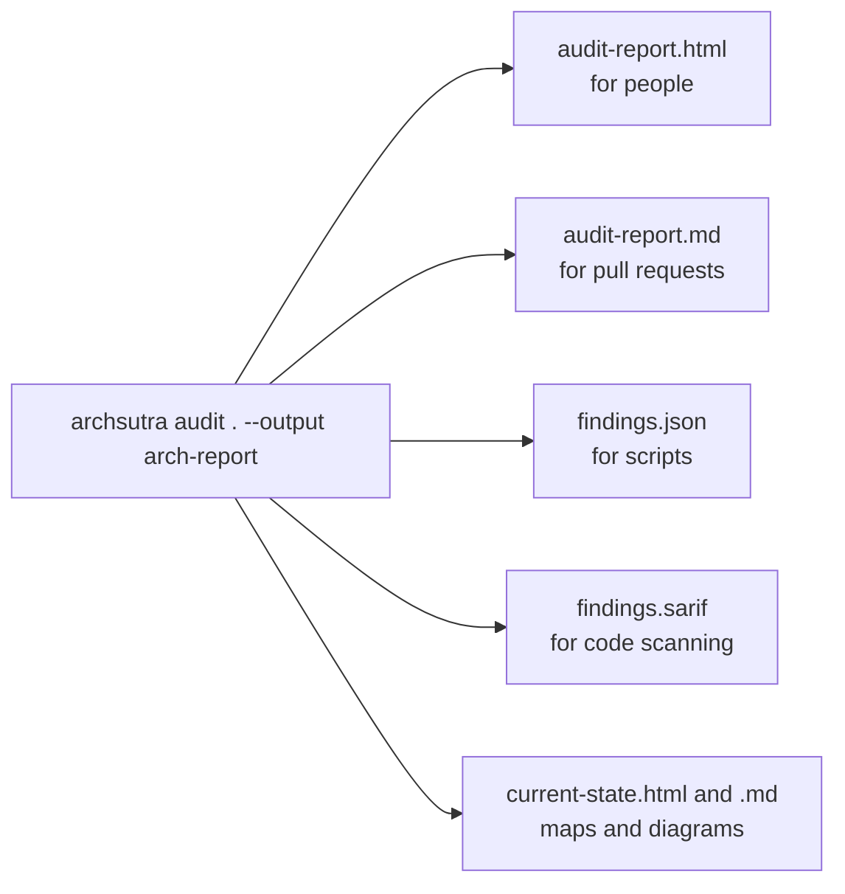
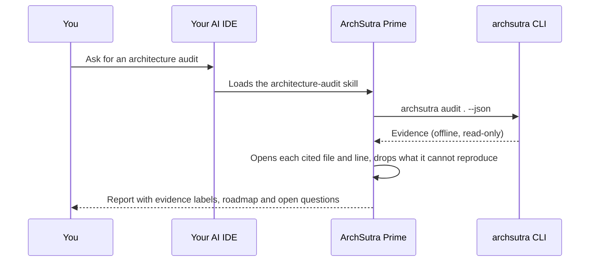

# Get started in 5 minutes

<!-- summary: From zero to a readable architecture report in five minutes: pick your path, run one command, open the report, then bring in your AI IDE and CI. -->

By the end of this page you will have an **audit report you can open in a browser**, you will know what each part means, and you will know the next step for your situation. You do not need an account, an API key or network access for the first four steps.

> **Tip.** Short on time? Run step 1 and step 2, then read [Reading a report](reading-a-report.md). That alone is a useful 3 minutes.

## Pick your path

Start from what you want, not from the tool.



## Step 1. Run your first audit

You need Node.js 20 or newer. From the root of any project:

```bash
npx archsutra-ai audit .
```

On Windows `npx archsutra-ai` works from version 0.1.3. The command reads your files, never runs them, never uses the network, and prints a report. Here is the **real output** for the small sample project in this repository:

> **Real output.** Trimmed from `archsutra audit fixtures/brownfield-monolith`.

```text
# Architecture Audit Report

## Summary
- Files scanned: 7
- Stack observed: TypeScript, Node.js
- Findings: 12 (critical 0, high 3, medium 7, low 2, info 0)

## Scorecard
| Category        | Rating       |
|-----------------|--------------|
| Security        | weak         |
| Maintainability | adequate     |
| Operability     | adequate     |
| Supply chain    | adequate     |
| Reliability     | not assessed |
| Performance     | not assessed |
| Cost            | not assessed |
```

> **Why it matters.** Notice `not assessed`. A static scan cannot see traffic, incidents or your cloud bill, so it says so instead of guessing. A tool that scores everything is a tool that makes things up.

## Step 2. Open the report as a web page

Reports that people can open are reports that get read. Write the full set, Markdown and HTML:

```bash
npx archsutra-ai audit . --output arch-report
```

```text
  index.html
  current-state.md
  current-state.html
  audit-report.md
  audit-report.html
  findings.json
  findings.sarif
  architecture-register.json
Open index.html in a browser. Each report also has a Markdown file beside it.
```

Open `arch-report/index.html`. You get severity cards, a filter by severity, and collapsible findings. Use the Markdown files in pull requests, the JSON in scripts, and the SARIF in GitHub code scanning.



> **Note.** `--output` must stay inside the project folder. That is a safety rule: the tool will not write outside the project you pointed it at.

## Step 3. Understand what you are looking at

Every finding has the same shape, so you can learn it once.


Read it top to bottom: **what** (title), **how bad** (severity), **how sure** (confidence), **where** (file and line), **so what** (impact), **now what** (fix), **how do I know** (verify and accept). If you cannot open the cited line and see the problem, treat the finding as wrong and tell us ([false-positive report](https://github.com/shahvatsalofficial/archsutra-ai/issues/new?template=false_positive.md)).

## Step 4. Add your AI IDE (optional, where the depth is)

The CLI gives evidence. Your IDE's own model adds judgment: why a design is risky, what to change first, what to design next. ArchSutra's skills tell the model how to do that without making things up.

Pick **one** host (several hosts read the same folders, so installing more than one duplicates skills):

| Your IDE | Command |
|---|---|
| Claude Code | `npx archsutra-ai install --host claude --target .` |
| Cursor | `npx archsutra-ai install --host cursor --target .` |
| OpenAI Codex | `npx archsutra-ai install --host codex --target .` |
| GitHub Copilot | `npx archsutra-ai install --host copilot --target .` |
| Gemini CLI | `npx archsutra-ai install --host gemini --target .` |

Preview first with `--dry-run`; undo any time with `uninstall`. Then ask:

> ArchSutra Prime: audit this repository's architecture. Establish what the code actually does first, then give findings with file and line evidence, severity and confidence, prioritized fixes and a phased roadmap. Stay read-only and label unknowns.



> **Warning.** Layouts for all five IDEs follow each vendor's documentation, but a live session in each has not been recorded yet. If a skill does not appear, run `archsutra doctor .` and tell us which IDE and version; we track it in the [smoke test log](../compatibility/smoke-tests/README.md).

## Step 5. Stop regressions in CI

Add one line to your pipeline so the same problems cannot come back:

```yaml
- run: npx --yes archsutra-ai audit . --fail-on high
```

The step passes when there are no high or critical findings and fails (exit code 1) when there are. On a codebase that already has findings, start with a baseline instead so only *new* problems fail the build; see [CI recipes](ci-recipes.md).

## If something goes wrong

| What you see | Why | Fix |
|---|---|---|
| `archsutra is not recognized` on Windows | Older version of the package | Use `npx archsutra-ai ...` with version 0.1.3 or newer |
| `--output must stay inside the project directory` | Safety rule | Use a relative folder such as `arch-report` |
| `Blocked: N conflicting file(s)` on install | A file already exists and was not installed by ArchSutra | Run with `--dry-run`, then `--force` (originals are backed up) |
| Skill not found in your IDE | Layout or version mismatch | `archsutra doctor .`, then open a smoke-test report |
| Report says TRUNCATED | Repository is larger than the scan limits | Audit a subfolder, or see [scan limits](../handbook/03-technical-specification.md) |

## Where to go next

- **New to the report?** [Reading and triaging a report](reading-a-report.md)
- **Want to see it used?** [Real-world scenarios](real-world-scenarios.md)
- **Curious how it works?** [How it works, in pictures](how-it-works.md)
- **Need a quick reference?** [Cheat sheet](cheat-sheet.md)
- **Do you trust the numbers?** [Evidence at a glance](evidence-at-a-glance.md)
