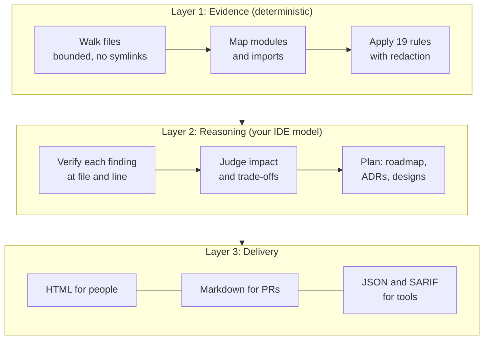
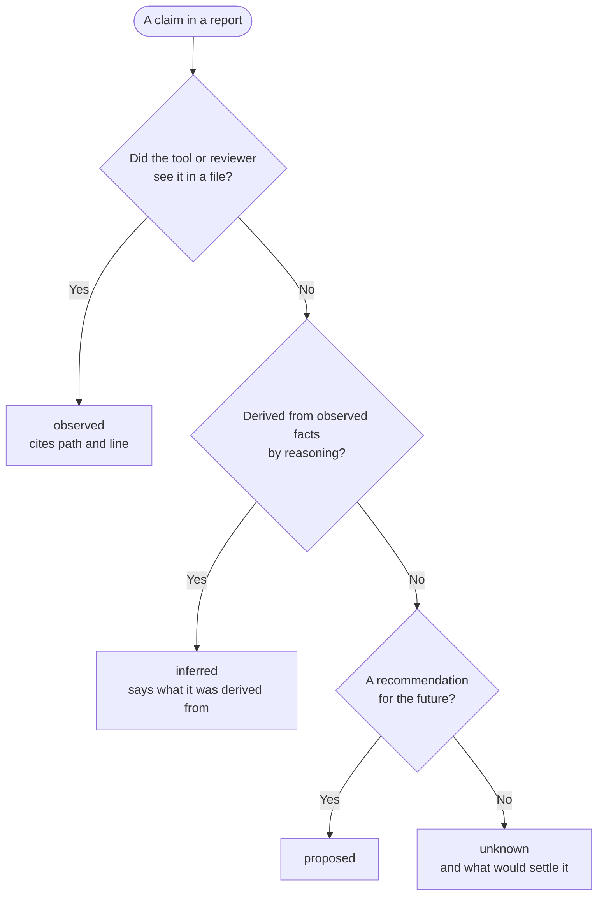
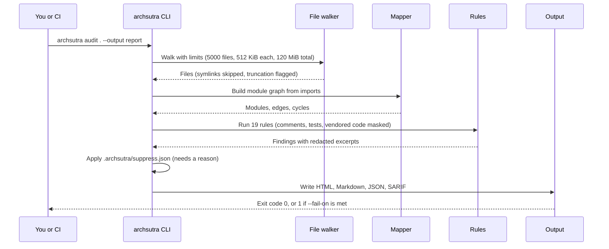
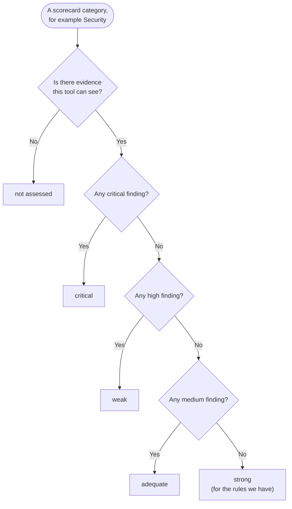
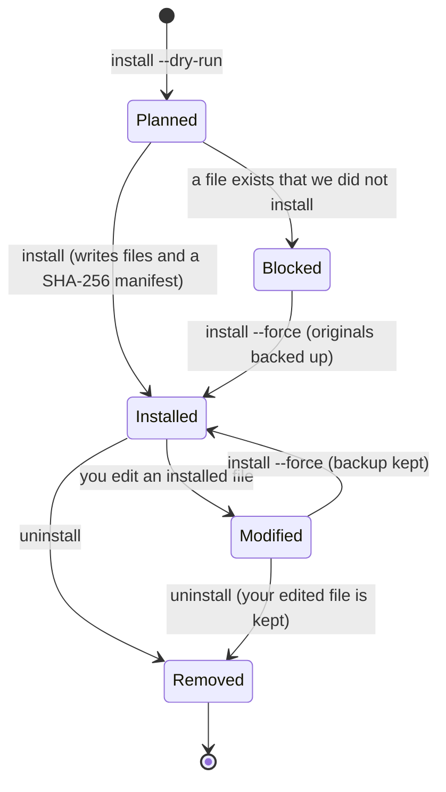
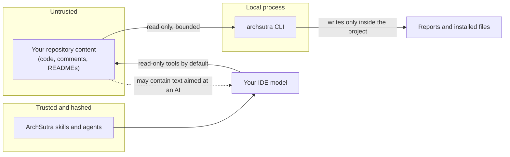

# How it works, in pictures

<!-- summary: Seven diagrams that explain ArchSutra end to end: the pipeline, the three layers, evidence labels, a scan from the inside, how scores are decided, the install lifecycle and the trust boundaries. -->

You can use ArchSutra without reading this page. Read it when you want to know *why* the output looks the way it does and *how far to trust it*. Each picture answers one question.

## 1. The big picture: who does what?

Two parts, two jobs:

- The **CLI** is a measuring tool. It always gives the same answer for the same input, runs offline and never calls a model. That makes it testable and safe in CI.
- The **skills and agents** are a method for your IDE's model. They stop the model from guessing and make it check its own work.

Neither needs an ArchSutra account or key.

## 2. Three layers, three kinds of trust

How much to trust each layer:

| Layer | Reproducible? | Can be wrong? | How we limit that |
|---|---|---|---|
| 1. Evidence | Yes, byte for byte | Yes, rules are heuristics | Measured on real repositories; every finding lists caveats |
| 2. Reasoning | No, models vary | Yes | Skills require citing evidence and labeling claims |
| 3. Delivery | Yes | Only if layers 1 or 2 were | Escaped output; sources linked |

## 3. Every claim wears a label

> **Why it matters.** Most bad architecture advice is a guess presented as a fact. Labels let you see the difference at a glance, and they let a reviewer challenge exactly the part that is shaky.

## 4. A scan from the inside

Three details worth knowing:

- **Limits are always reported.** If a repository is too big, the report says TRUNCATED. It never silently scans half.
- **Noise is filtered before you see it.** Comments, docstrings, test files, vendored libraries, minified bundles and dummy values are ignored. That is what raised measured precision from 50% to 69% and 95% ([evidence](evidence-at-a-glance.md)).
- **Suppression needs a reason.** A row without a reason in `.archsutra/suppress.json` is ignored, and expired rows stop applying.

## 5. How a rating is decided

Reliability, performance, scalability, data integrity and cost are **always** `not assessed` from a static scan: they need traffic, incidents, data volumes or billing. A `strong` rating means "no findings from these 19 rules", which is not the same as "no problems".

## 6. Install lifecycle: safe, reversible, never destructive

The manifest at `.archsutra/install-manifest.json` records a hash of every file it wrote. `uninstall` deletes a file only if its hash still matches, so your edits are never lost.

## 7. Trust boundaries: what can touch what

The dotted line is the real risk: text inside a repository can try to instruct an AI. ArchSutra's answer is layered: skills declare repository content to be data, agents get read-only tools, and the CLI never executes anything it reads. Residual risk is documented in the [threat model](../architecture/threat-model.md).

## Keep going

- Use it on something real: [Real-world scenarios](real-world-scenarios.md)
- The full reasoning behind the design: [Architecture](../handbook/04-architecture.md)
- Every rule: [Rule catalog](../handbook/12-rule-catalog.md)
