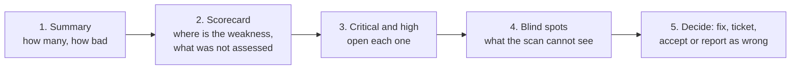
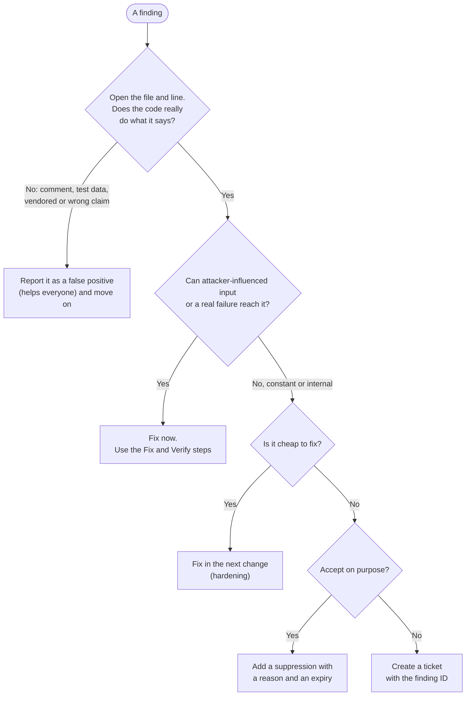
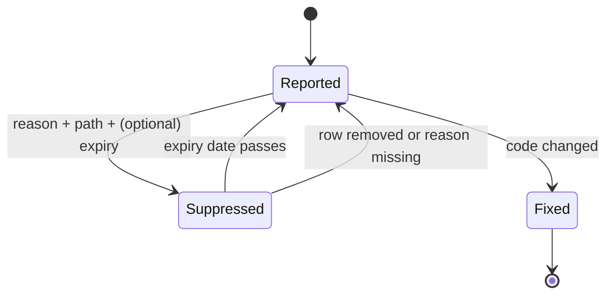

# Reading and triaging a report

<!-- summary: How to read an ArchSutra report, decide what to fix first, accept risk on purpose, and tell us when a finding is wrong. -->

A report is only useful if you can decide what to do with it in a few minutes. This page gives you a reading order, a triage flowchart you can follow without thinking, and the rules for accepting a finding on purpose.

## The reading order (5 minutes)



1. **Summary.** Counts by severity, files scanned, and whether the scan was cut off (`TRUNCATED`).
2. **Scorecard.** Five categories get a rating from the rules we have; five (reliability, performance, scalability, data integrity, cost) are always `not assessed` from a static scan.
3. **Critical and high findings.** Open each in the HTML report (they start expanded).
4. **Scope and blind spots.** The honest list of what this report cannot tell you.

## Severity, confidence and actionability are three different things

| Word | Question it answers | Example |
|---|---|---|
| **Severity** | If this is real, how much does it matter? | An exposed key is critical; a missing README is low |
| **Confidence** | How sure is the rule that it is real? | A committed private key is high; a "possible credential" is medium; an inferred AI-risk co-location is low |
| **Actionable** | Would the owners actually change something? | `eval` of a developer-typed value in a migration tool: real, but by design |

> **Why it matters.** On 52 real repositories, most reported findings were genuine instances of the rule, but **about half were not worth acting on**. That is not a bug in your report: it is the difference between "this code does X" and "X is a problem here". Triage is where a human adds value ([evidence](evidence-at-a-glance.md)).

## Triage flowchart

Follow it for every high or critical finding.



## What the common findings usually mean

| Rule | Usually means | Often a false alarm when |
|---|---|---|
| AS-SEC-001 possible credential | A real secret, or a default password in seed data | The value is a placeholder such as `password`, or a public key (search-only keys, Firebase web keys) |
| AS-SEC-002 private key committed | Rotate it, even if you think it is a test key | It is clearly an example key in docs (verify it is unused) |
| AS-SEC-004 dynamic execution | Injection sink: check what reaches it | Constant input, or tooling that must hide an import |
| AS-SEC-005 SQL by interpolation | Injection risk | The interpolated value is an internal, already-quoted identifier |
| AS-ARC-001 cycle | Modules cannot be understood or split independently | A cycle among test helpers or via a data file import (we ignore the common cases) |
| AS-OPS-003 root container | Hardening gap | A dev container that is never deployed |
| AS-SUP-001/002/003 | Builds that are not reproducible | Intentional in a throwaway demo |

The full list with limits is the [rule catalog](../handbook/12-rule-catalog.md).

## Accept a risk on purpose (and keep it honest)

Create `.archsutra/suppress.json` in the project:

```json
{
  "suppress": [
    {
      "rule": "AS-OPS-003",
      "path": "tools/devcontainer/Dockerfile",
      "reason": "Local dev container, never deployed",
      "expires": "2027-06-30"
    }
  ]
}
```

Three rules keep suppression from becoming a hiding place:

- **A reason is required.** A row without one is ignored.
- **It expires.** After `expires` the finding comes back for review.
- **It is specific.** A rule plus a path, not a blanket ignore.



## Tell us when a finding is wrong

False positives are the most valuable feedback we get. They became the regression tests that raised measured precision from 50% to 69% and then 95%.

1. Note the rule ID and the file and line.
2. Say why it is wrong: comment or docstring, vendored code, test data, placeholder, wrong rule claim.
3. Open a [false-positive report](https://github.com/shahvatsalofficial/archsutra-ai/issues/new?template=false_positive.md).

## What a report is not

> **Warning.** A report from this tool is a review aid. It is not a certification, a compliance attestation or a penetration test, and "no findings" is not "no problems". See the [legal notes](../handbook/07-security-privacy-legal.md).

## Next

- Turn findings into a plan: ask Prime for a roadmap ([scenario 1](real-world-scenarios.md#1-day-one-on-a-legacy-monolith)).
- Stop new ones: [CI recipes](ci-recipes.md).
