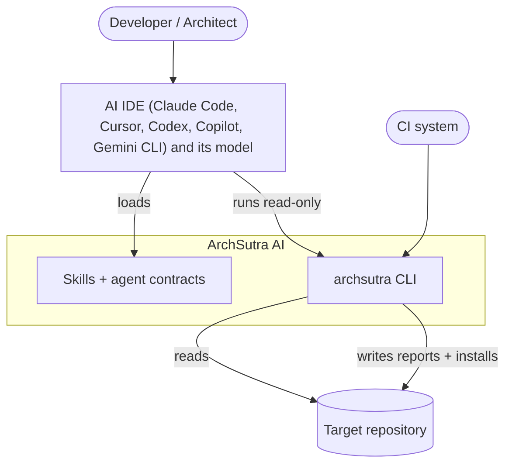
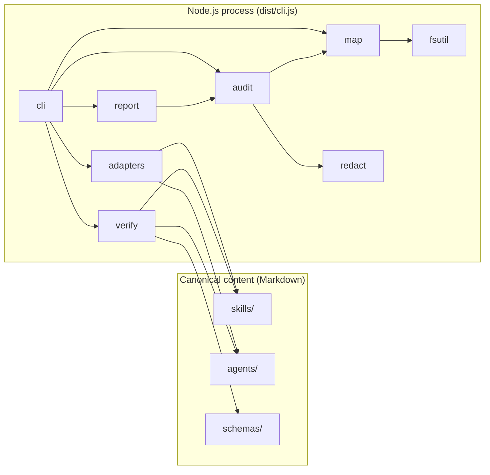
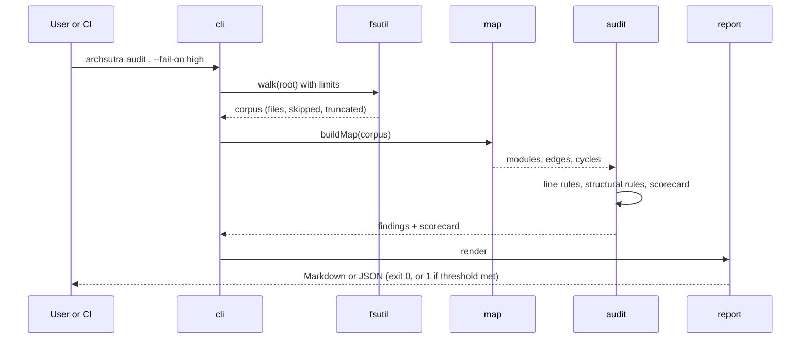
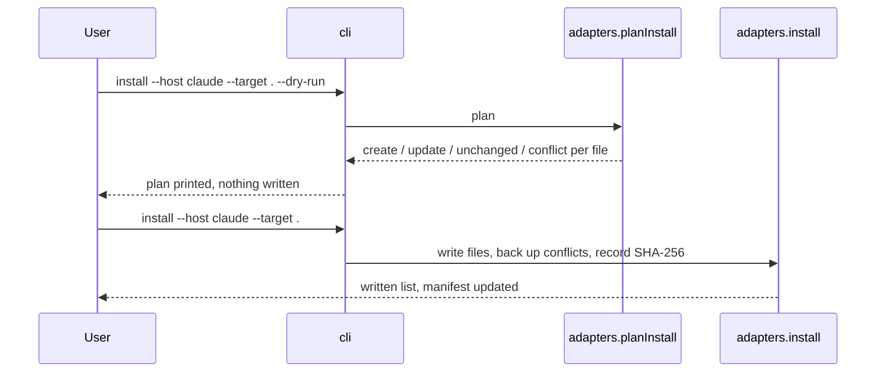
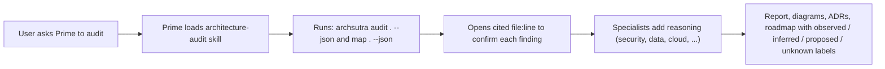
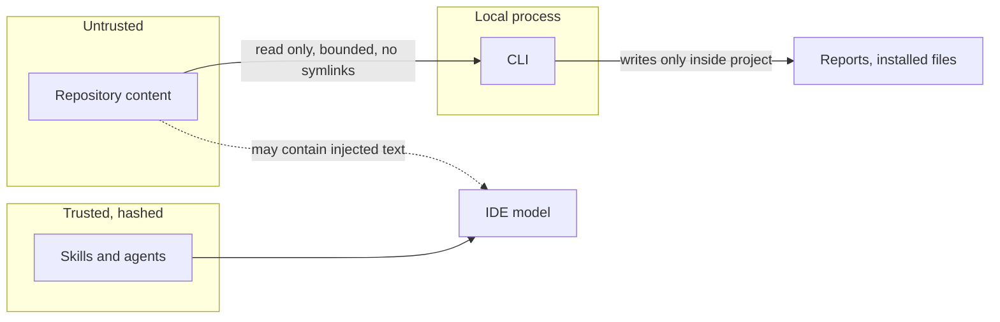

# Architecture

<!-- summary: C4 views, runtime flows, trust boundaries, quality attributes and the decisions behind ArchSutra AI. -->

Notation: C4 model (Context, Container, Component), diagrams in Mermaid. Every element corresponds to something in the repository.

## 1. System context (C4 level 1)

Key point: the **model never lives inside ArchSutra**. The IDE supplies reasoning; ArchSutra supplies method and measured evidence.

## 2. Containers (C4 level 2)

## 3. Components (C4 level 3) of the CLI

| Component | Depends on | Responsibility |
|---|---|---|
| `cli` | all | parse arguments, dispatch, exit codes |
| `audit` | `map`, `fsutil`, `redact` | rules and scorecard |
| `map` | `fsutil`, `redact` | modules, imports, cycles, stack |
| `report` | types | render outputs |
| `verify` | `fsutil` | structural validation |
| `adapters` | `fsutil`, `verify` | host table, install plan, install, uninstall, doctor |
| `fsutil` | none | safe bounded filesystem access |
| `redact` | none | secret detection and masking |

Dependencies are acyclic. The tool's own audit reports no module cycles.

## 4. Runtime flows

### 4.1 Audit

### 4.2 Install

### 4.3 AI-assisted audit (the full loop)

## 5. Trust boundaries

Controls and residual risk are in the [threat model](../architecture/threat-model.md).

## 6. Quality attributes

| Attribute | Strategy | Verified by |
|---|---|---|
| Security | read-only default, redaction, containment, hashed installs | security tests |
| Privacy | offline, no telemetry | design + code review |
| Reliability | skip-on-error scanning, bounded work | limit tests |
| Portability | Node only, no shell dependency in core | 3-OS CI |
| Maintainability | small modules, acyclic, typed | self-audit, typecheck |
| Testability | pure render functions, runtime-built fixtures | 20 tests |
| Extensibility | declarative host table, rule table, agent contract | contributor guide |
| Honesty | support levels, `not assessed`, caveats on every finding | review |

## 7. Architectural decisions

| ADR | Decision |
|---|---|
| [ADR-0001](../decisions/ADR-0001-deterministic-cli-plus-ide-skills.md) | Deterministic CLI for evidence plus IDE-native skills for reasoning; no server, no API key |

Additional decisions captured in the [RFC](../rfc/0001-archsutra-v0.1.md): single canonical source with generated host layouts; honest capability labels; zero runtime dependencies; module-level (not file-level) dependency graph for stability.

## 8. Documentation site

The HTML site is generated by `scripts/build-docs.mjs` from this handbook's Markdown. It is static, has no framework, supports light and dark themes, keyboard navigation, a skip link, visible focus, reduced-motion, print styles, and loads one optional script (Mermaid, pinned) from a CDN. Markdown remains the source of truth.

## 9. Evolution

Planned additions are intentionally outside the keyless path: optional local model runtime and optional bring-your-own-key server. They must not change default behavior. See [Compatibility and roadmap](09-compatibility-and-roadmap.md).
