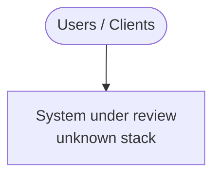
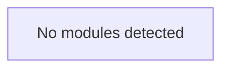

# Current State (observed)

Generated by: archsutra map (deterministic, no AI inference)

## Stack

- Ecosystems: unknown
- Frameworks (from manifests): none detected
- Datastores / messaging (from manifests): none detected
- Infrastructure files: none detected
- Entry points: none detected

## System context (C4 L1, inferred from manifests)

## Modules and dependencies (C4 L2-style, observed imports)

| Module | Files | Lines | Languages |
|---|---|---|---|

## Dependency cycles

_None detected at module level._

## Blind spots

- Runtime behaviour, deployed topology, and data volumes are not observable from source alone.
- Dependency edges are module-level. JS/TS uses relative imports. Python uses the top package name. Go, Java, Kotlin, C#, and Rust match an import suffix to a module path. Dynamic imports, path aliases, and DI wiring may be missed. PHP, Ruby, Swift, and Dart are detected and not graphed.
