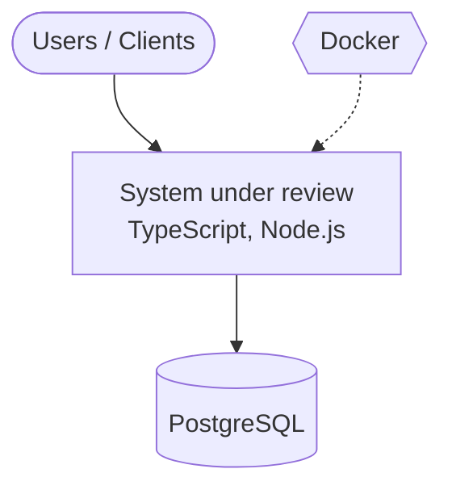
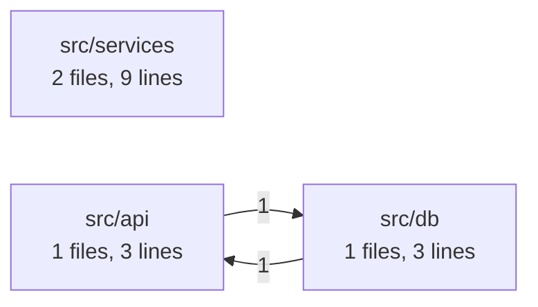

# Current State (observed)

Generated by: archsutra map (deterministic, no AI inference)

## Stack

- Ecosystems: TypeScript, Node.js
- Frameworks (from manifests): Express
- Datastores / messaging (from manifests): PostgreSQL
- Infrastructure files: Docker
- Entry points: none detected

## System context (C4 L1, inferred from manifests)

## Modules and dependencies (C4 L2-style, observed imports)

| Module | Files | Lines | Languages |
|---|---|---|---|
| `src/services` | 2 | 9 | TypeScript |
| `src/api` | 1 | 3 | TypeScript |
| `src/db` | 1 | 3 | TypeScript |

## Dependency cycles

- src/api <-> src/db

## Blind spots

- Runtime behaviour, deployed topology, and data volumes are not observable from source alone.
- Dependency edges are module-level and based on relative imports; dynamic imports and DI wiring may be missed.
