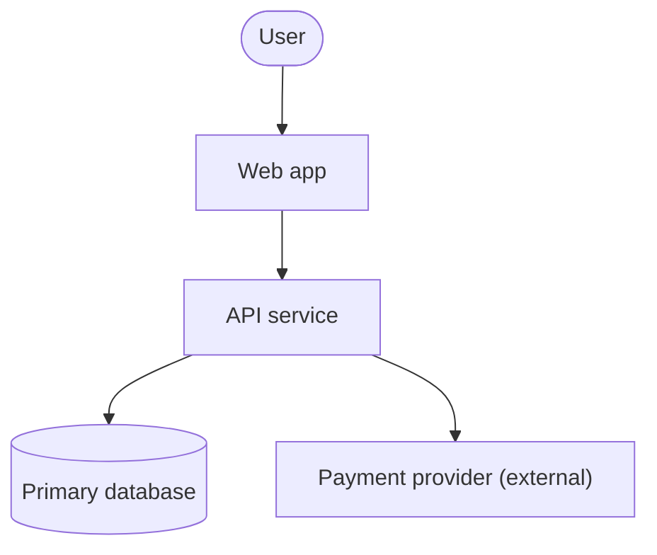

# Design document template

Keep it as short as the audience allows. Delete sections that do not apply and say why in one line.

1. **Summary.** The problem, the chosen architecture in 3 sentences, the biggest risk.
2. **Requirements and NFRs.** The table from the NFR checklist, with ids (R1, R2, ...). Assumptions marked `unknown` or `assumed`.
3. **Options considered.** Scoring table, sensitivity note, link to the ADR.
4. **Context (C4 level 1).** Mermaid diagram of the system, users and external systems.
5. **Containers (C4 level 2).** Deployable units, datastores, queues. For each: responsibility, technology, owner, the requirement ids it serves.
6. **Key flow.** One Mermaid sequence diagram of the most important or riskiest flow, including failure paths.
7. **Data.** Entities, owner of each, consistency model per flow, retention, personal data, migration approach.
8. **APIs and integration.** Style (REST, events, gRPC), versioning, idempotency, error semantics, limits of third parties.
9. **Security.** Identity, authorization model, trust boundaries, secrets, data classification. Link to the threat model if one exists.
10. **Deployment and operations.** Environments, release strategy, rollback, observability, SLOs, backup and restore, runbook owner.
11. **Cost.** Drivers, formula, low and expected scenarios, pricing source and date, currency.
12. **Roadmap.** Thin slice, milestones with acceptance tests, risks and mitigations.
13. **Open questions and unknowns.** With an owner and a date.

## Mermaid starter (context diagram)

Keep labels short and every element traceable to a requirement.
